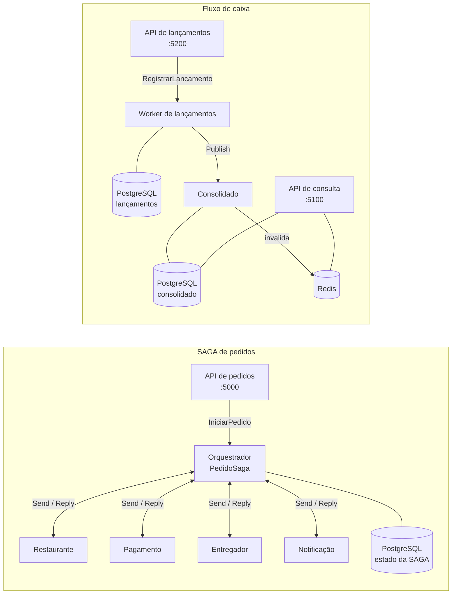

# SAGA orquestrado + CQRS com Rebus e RabbitMQ

[](https://github.com/felipemarcianodev/saga-poc-dotnet/actions/workflows/ci.yml)


Prova de conceito com dois contextos, que sobem juntos no Docker Compose:

- **SAGA orquestrado** para delivery de comida: restaurante, pagamento, entregador e notificação, com compensação em ordem reversa quando uma etapa falha.
- **Fluxo de caixa com CQRS:** lançamentos gravados por uma API e um worker, eventos publicados no RabbitMQ e um consolidado diário lido com cache (HTTP, memória e Redis).

Não é código de produção. É um exemplo de decisões técnicas reais, com as limitações declaradas (ver [Limitações conhecidas](#limitações-conhecidas)).

---

## Por que este repositório existe

Explicar SAGA só em texto não estava funcionando. A conversa sempre escorregava para mensageria, ferramenta ou framework, e o problema real ficava de fora.

A dor que este código tenta expor é comum em sistemas distribuídos: **o fluxo funciona, mas o significado não está claro.** SAGA coordena execução; não garante entendimento. A dificuldade raramente está em publicar eventos ou implementar compensações. Ela aparece quando os contratos são implícitos, o versionamento vira formalidade e cada serviço interpreta o domínio de um jeito.

Algumas decisões aqui são intencionalmente discutíveis. Se você discordar de alguma, o objetivo foi cumprido.

---

## Arquitetura em uma página



Toda a comunicação entre serviços passa pelo RabbitMQ, via Rebus.

**SAGA.** O orquestrador manda um comando por vez e decide o próximo passo pela resposta. O estado fica no PostgreSQL, em tabelas criadas e mantidas pelo próprio Rebus. Quando uma etapa falha, as anteriores são desfeitas em ordem reversa:

| Etapa que falhou | Compensação |
|---|---|
| Restaurante | Nenhuma: a SAGA é cancelada |
| Pagamento | Cancelar o pedido no restaurante |
| Entregador | Estornar o pagamento e cancelar no restaurante |
| Notificação | Nenhuma: o pedido continua confirmado |

**Fluxo de caixa.** A API de lançamentos só aceita o comando (202). O worker grava o lançamento e publica `LancamentoCreditoRegistrado` ou `LancamentoDebitoRegistrado`. O Consolidado assina esses eventos, atualiza o saldo do dia e apaga a chave do dia no Redis.

Detalhes em [arquitetura.md](arquitetura.md); padrões internos em [design/](design/); decisões em [decisoes-tecnicas/](decisoes-tecnicas/).

---

## Como rodar

Pré-requisitos: **Docker** com Compose e, para build e testes fora do container, o **.NET 10 SDK**.

```bash
git clone https://github.com/felipemarcianodev/saga-poc-dotnet.git
cd saga-poc-dotnet

docker compose -f docker/docker-compose.yml up -d --build
bash docs/scripts/aguardar-stack.sh     # espera APIs, filas e assinaturas
```

| Serviço | Endereço |
|---|---|
| API de pedidos (SAGA) | http://localhost:5000 (Swagger na raiz) |
| API de lançamentos (escrita) | http://localhost:5200/swagger |
| API do fluxo de caixa (consulta) | http://localhost:5100/swagger |
| RabbitMQ (management) | http://localhost:15672 (`saga` / `saga123`) |
| Seq (logs) | http://localhost:5342 (`admin` / `admin123`) |
| Jaeger (traces) | http://localhost:16686 |

Para derrubar: `docker compose -f docker/docker-compose.yml down` (com `-v`, apaga também os dados). Operação da stack e consultas SQL em [docker/README.md](../docker/README.md).

### Build e testes

```bash
dotnet build SagaPoc.sln
dotnet test SagaPoc.sln
```

---

## Como validar

O 202 das APIs só diz que o pedido foi aceito. O que vale é o desfecho, e os scripts conferem isso:

```bash
bash docs/scripts/testar-casos-de-uso.sh     # 14 casos da SAGA, pelo log do orquestrador
bash docs/scripts/testar-fluxo-caixa.sh      # 4 cenários, do lançamento ao saldo consolidado
```

Os dois saem com código 1 se algo divergir. O [CI](../.github/workflows/ci.yml) roda build, testes e os dois scripts com a stack no compose em todo PR. Casos, payloads e desfechos esperados: [scripts/readme-script.md](scripts/readme-script.md) e [casos-uso.md](casos-uso.md).

Exemplo manual (caso 1, pedido normal):

```bash
curl -X POST http://localhost:5000/api/pedidos \
  -H "Content-Type: application/json" \
  -d '{
    "clienteId": "CLI001",
    "restauranteId": "REST001",
    "itens": [{ "produtoId": "PROD001", "nome": "Pizza Margherita", "quantidade": 1, "precoUnitario": 45.90 }],
    "enderecoEntrega": "Rua das Flores, 123 - Centro",
    "formaPagamento": "CREDITO"
  }'

docker logs saga-orquestrador 2>&1 | grep "\[SAGA\]"
```

No Git Bash do Windows, JSON com acento passado direto no argumento do `curl` chega corrompido; envie como arquivo (`--data-binary @pedido.json`).

---

## Limitações conhecidas

- **Status do pedido é mock.** `GET /api/pedidos/{id}/status` sempre responde "EmProcessamento". O Rebus remove a SAGA concluída do banco, e ainda não há uma projeção com o desfecho.
- **Sem outbox.** Se um serviço cair entre gravar no banco e enviar a mensagem, o estado e a mensageria divergem. No worker de lançamentos isso pode duplicar um lançamento: cada nova tentativa gera um `Id` novo.
- **Resposta depois do prazo é descartada.** A SAGA tem prazo (30 s para o pedido, 30 s para a compensação), mas, depois que ela termina, o Rebus descarta em silêncio as respostas que ainda chegarem. Um restaurante que valida o pedido depois do prazo fica com um pedido que ninguém cancela, e um pagamento aprovado depois do prazo não é estornado. Resolver exige compensação pelo `CorrelacaoId` nos próprios serviços.
- **Compensação que falha só fica no log.** Quando um estorno é recusado em todas as tentativas, a SAGA termina como `COMPENSAÇÃO FALHOU` com log de erro, mas o registro some com ela: não há fila de intervenção manual nem alerta.
- **Idempotência das compensações em memória.** Estorno e liberação de entregador são deduplicados por um repositório em memória, que se perde quando o serviço reinicia.
- **Consolidado sem controle de concorrência.** Ele processa uma mensagem por vez (`MaxParallelism = 1`); escalar exige concorrência otimista ou UPDATE atômico.
- **Consulta pode vir defasada até cerca de 60 s.** O Consolidado invalida o Redis, mas a API de consulta também tem cache em memória e response cache, que não são invalidados.
- **Testes automatizados só no domínio do fluxo de caixa.** A SAGA e as APIs são validadas pelos scripts de ponta a ponta, não por testes de integração.
- **Observabilidade parcial.** No Jaeger aparecem só a API de pedidos e os serviços de lançamentos; o orquestrador e os serviços da SAGA não geram span. Os logs vão para o console e para o Seq; em build Debug (`BUILD_CONFIGURATION=Debug` no compose), também para `logs/` na raiz.
- **Serviços simulados.** Restaurante, pagamento, entregador e notificação decidem pelo conteúdo do pedido. O entregador recusa 30% das alocações entre 12h e 14h59 UTC (horário de pico), simulação que se desliga com `SIMULAR_HORARIO_PICO=false`.
- **Sem autenticação** nas APIs.
- **Sem medição de desempenho.** Nenhum número de latência ou vazão foi medido; as metas citadas nos ADRs são objetivos.

---

## Documentação

| Documento | Conteúdo |
|---|---|
| [arquitetura.md](arquitetura.md) | Serviços, comunicação, deploy e observabilidade |
| [design/](design/) | Padrões internos (SAGA, CQRS, Result Pattern, Unit of Work) e escolhas de tecnologia |
| [decisoes-tecnicas/](decisoes-tecnicas/) | ADRs |
| [casos-uso.md](casos-uso.md) | Os 14 casos da SAGA |
| [diagramas-compensacao.md](diagramas-compensacao.md) | Estados e compensações da SAGA |
| [fluxo-caixa.md](fluxo-caixa.md), [diagramas-fluxo-caixa.md](diagramas-fluxo-caixa.md) | Contexto de fluxo de caixa |
| [runbook-troubleshooting.md](runbook-troubleshooting.md), [troubleshooting-fluxo-caixa.md](troubleshooting-fluxo-caixa.md) | Diagnóstico operacional |
| [boas-praticas.md](boas-praticas.md) | Aprendizados do projeto |

---

## Licença

[MIT](../LICENSE).
