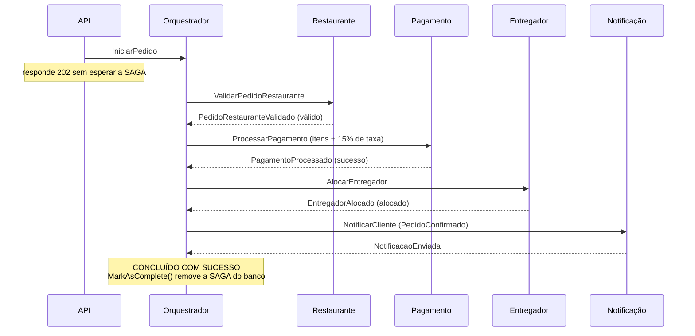
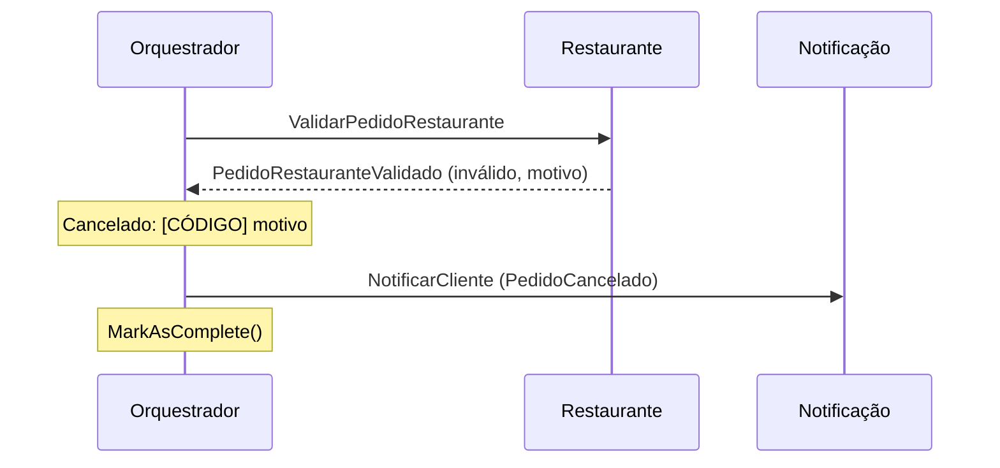
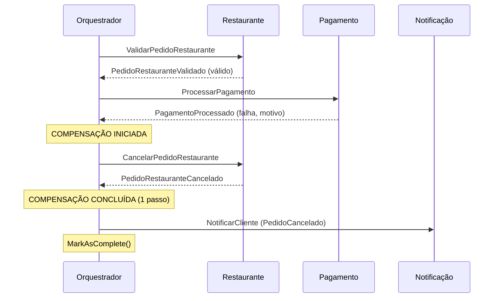
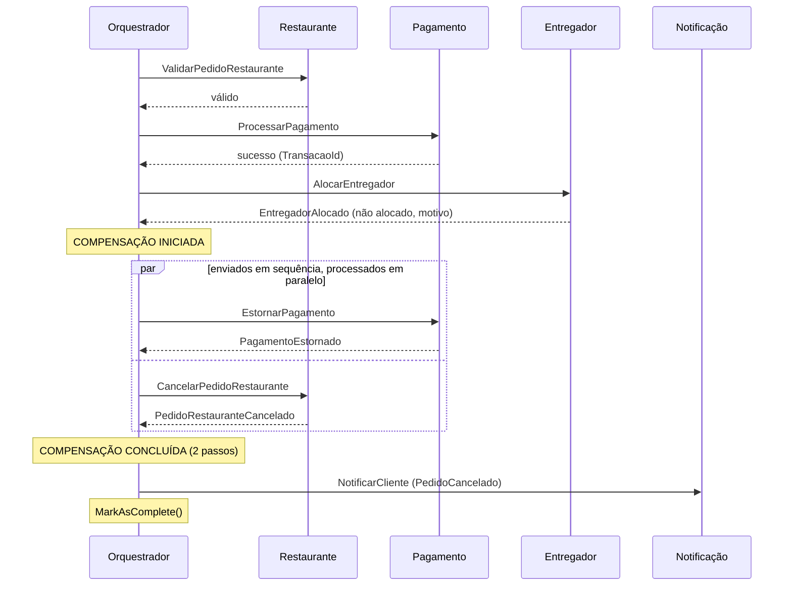
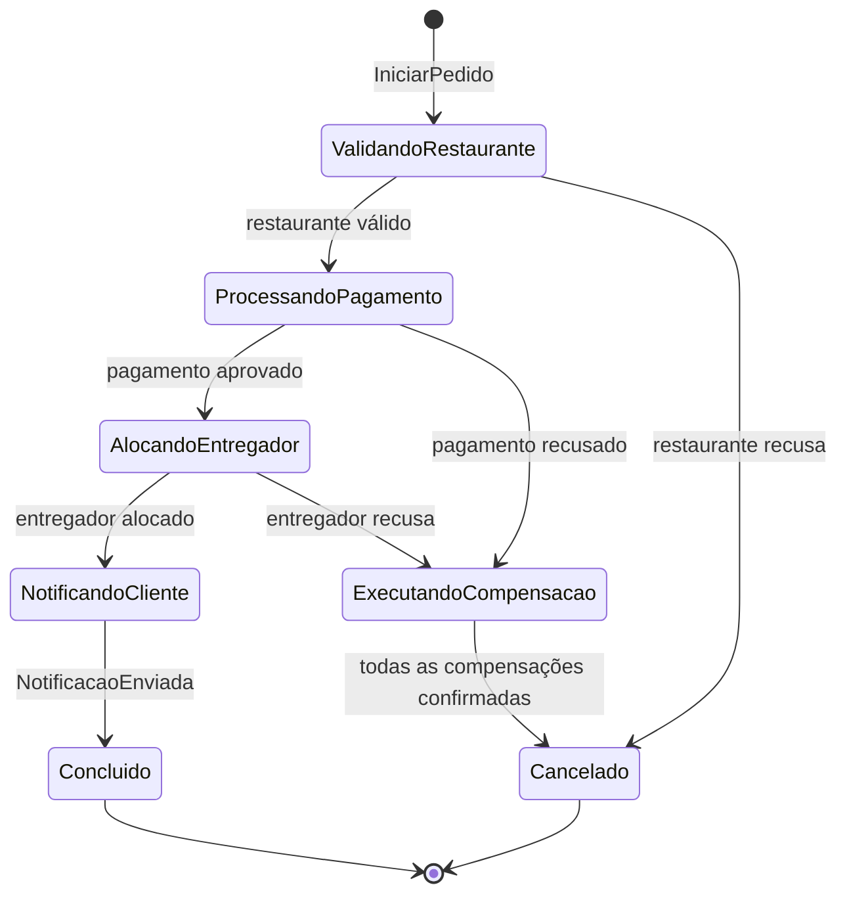

# Diagramas de compensação da SAGA

Fluxos de sucesso e de compensação da `PedidoSaga` (`src/SagaPoc.Orquestrador/Sagas/PedidoSaga.cs`), como estão implementados. Os casos citados são os de [casos-uso.md](./casos-uso.md).

Toda a comunicação passa pelo RabbitMQ: a SAGA envia comandos (`Send`) para a fila de cada serviço, e o serviço responde (`Reply`) para a `fila-orquestrador`. O estado da SAGA fica no PostgreSQL, na tabela `pedido_saga_data`, criada e mantida pelo Rebus.

---

## 1. Fluxo de sucesso (referência)

Casos 1, 7, 8, 9, 10 e 11.

A resposta da notificação conclui a SAGA mesmo quando o envio falhou (caso 10): `NotificacaoEnviada` carrega `Enviada = false`, e o orquestrador não olha esse campo.

---

## 2. Restaurante recusa (sem compensação)

Casos 2 e 3. Nada foi feito ainda, então não há o que desfazer.

A SAGA é concluída no mesmo handler que envia a notificação; a resposta da notificação chega depois que a SAGA já saiu do banco e não tem efeito.

---

## 3. Pagamento falha: cancela no restaurante

Casos 4 e 6.

---

## 4. Entregador falha: estorna e cancela

Casos 5 e 12, e qualquer pedido recusado no horário de pico simulado ou com o pool de entregadores esgotado.

O orquestrador envia o estorno antes do cancelamento, mas as duas respostas podem chegar em qualquer ordem. A cada resposta, `VerificarSeCompensacaoCompleta()` confere se todos os passos feitos (`RestauranteValidado`, `PagamentoProcessado`, `EntregadorAlocado`) têm a compensação registrada em `PassosCompensados`; só então a SAGA é finalizada.

As duas respostas podem ser processadas ao mesmo tempo (o orquestrador usa `MaxParallelism = 10`). O Rebus controla a concorrência da SAGA pela coluna `revision`: a segunda gravação falha por conflito e a mensagem é reprocessada com o estado atualizado.

---

## 5. Estados da SAGA

Valores de `EstadoAtual` em `PedidoSagaData`:

O estado final não é persistido: ao chegar em `Concluido` ou `Cancelado`, a SAGA chama `MarkAsComplete()` e o Rebus apaga a linha. Por isso `GET /api/pedidos/{id}/status` ainda é mock, e o desfecho só aparece no log `[SAGA]` do orquestrador.

Não existe estado separado para "compensado": recusa no restaurante e compensação concluída terminam ambas em `Cancelado`. O script de casos de uso distingue os dois pela linha de log (`Cancelado:` ou `COMPENSAÇÃO CONCLUÍDA`).

---

## 6. Matriz de compensação

| Falha em | Restaurante | Pagamento | Entregador | Compensações executadas |
|---|---|---|---|---|
| Validação do restaurante | recusou | não chamado | não chamado | nenhuma |
| Pagamento | validado | recusou | não chamado | cancelar no restaurante |
| Entregador | validado | aprovado | recusou | estornar pagamento e cancelar no restaurante |
| Notificação | validado | aprovado | alocado | nenhuma: a SAGA conclui |

`LiberarEntregador` está implementado no serviço e tratado pela SAGA (`EntregadorLiberado`), mas nenhum fluxo atual o envia: não há etapa compensável depois da alocação.

---

## 7. Idempotência e falhas na compensação

O que o código garante hoje:

- **Início duplicado:** o handler de `IniciarPedido` ignora a mensagem se a SAGA já existe (`IsNew`).
- **Estorno repetido:** o handler do pagamento guarda a chave `estorno:{TransacaoId}` num repositório de idempotência em memória, e o serviço marca a transação como estornada; uma segunda chamada responde sucesso sem estornar de novo.
- **Liberação repetida:** o serviço de entregador guarda a chave `liberacao:{EntregadorId}:{CorrelacaoId}` num repositório de idempotência em memória.
- **Cancelamento repetido no restaurante:** sobrescreve o mesmo registro em memória, sem efeito adicional.

Esses controles vivem na memória de cada serviço e se perdem quando o container reinicia.

Quando um handler lança exceção, o Rebus repete a mensagem (sem política configurada, vale o padrão do Rebus: 5 tentativas imediatas, sem intervalo) e, esgotadas as tentativas, a move para a fila `error`. A resposta de falha que os handlers enviam antes de relançar a exceção não sai, porque o Rebus só envia as mensagens de saída quando o handler termina sem erro.

---

## O que pode dar errado

- **Compensação com falha contada como feita:** `PagamentoEstornado` e `PedidoRestauranteCancelado` têm um campo `Sucesso`, mas a SAGA não o lê; uma resposta de estorno com `Sucesso = false` entra em `PassosCompensados` e a SAGA termina com `COMPENSAÇÃO CONCLUÍDA`.
- **Compensação que nunca termina:** se o estorno ou o cancelamento for para a fila `error`, a SAGA fica em `ExecutandoCompensacao` para sempre. Não há timeout de SAGA nem alerta; a única pista é a mensagem na fila `error`.
- **Serviço sem resposta:** a SAGA não tem prazo para esperar uma resposta. Se uma resposta não chegar, o pedido fica parado no estado atual.
- **Estado dos serviços em memória:** um restart do serviço de pagamento entre a cobrança e o estorno faz o estorno falhar com "transação não encontrada", e pelo item acima essa falha passa despercebida pela SAGA.
- **Ordem das compensações:** estorno e cancelamento correm em paralelo. Para estes serviços simulados a ordem não importa; num sistema real em que ela importe, a SAGA teria de esperar uma confirmação antes de enviar o comando seguinte.
