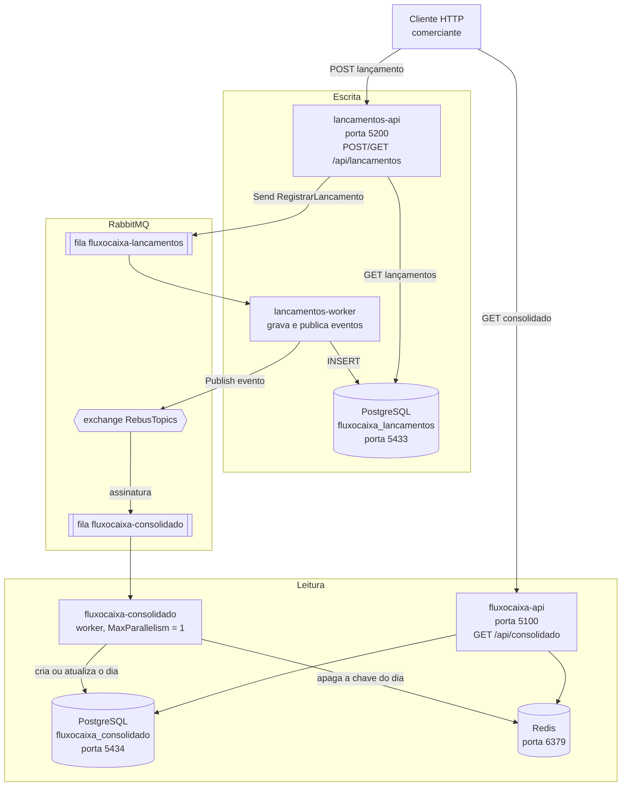
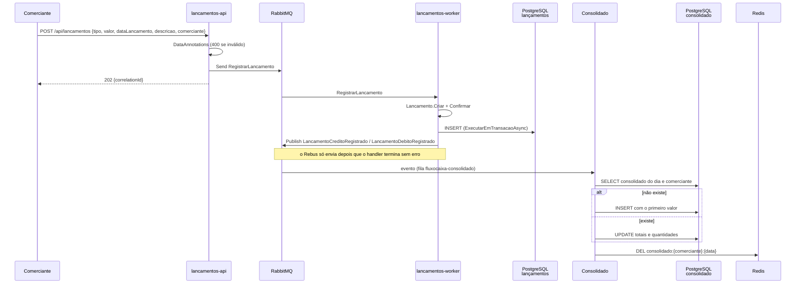
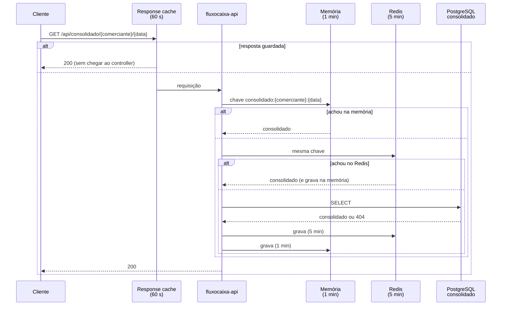
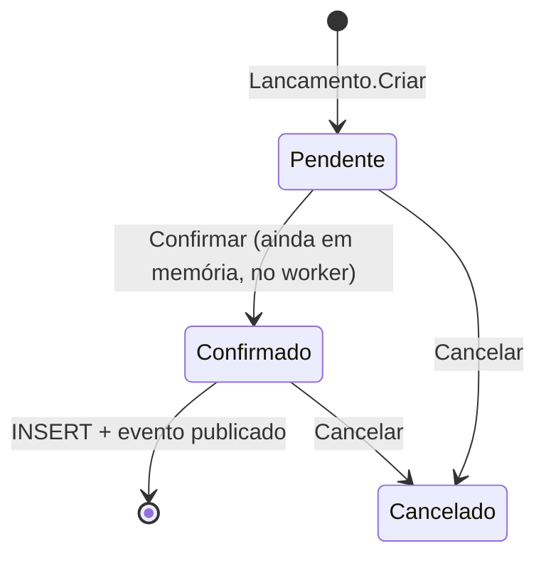
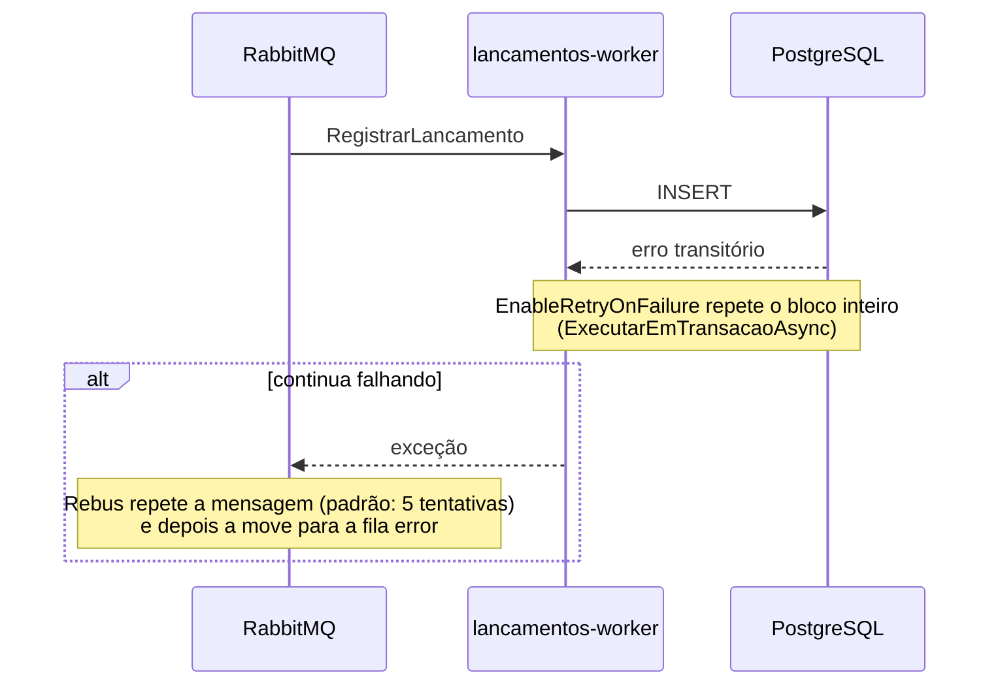
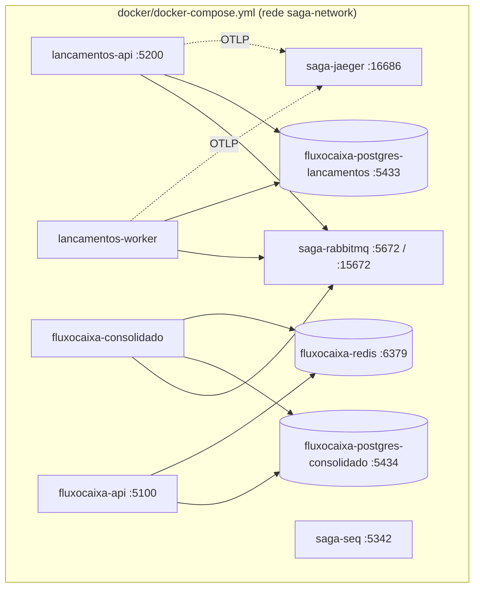

# Diagramas do fluxo de caixa

Diagramas de componentes e de sequência do contexto de Fluxo de Caixa (CQRS), como está no código e no `docker/docker-compose.yml`. O contexto está descrito em [fluxo-caixa.md](./fluxo-caixa.md).

---

## 1. Componentes

- A API de lançamentos não grava: valida o corpo (DataAnnotations), envia o comando e responde 202. O `GET /api/lancamentos` lê direto do banco de lançamentos.
- O worker de lançamentos publica `LancamentoCreditoRegistrado` ou `LancamentoDebitoRegistrado` (`Publish`). O Consolidado assina os dois ao subir; sem a assinatura, o RabbitMQ descartaria os eventos em silêncio.
- Cada worker migra o próprio banco ao subir; as APIs não migram.

---

## 2. Registrar um lançamento

Se o domínio recusar o lançamento no worker (`Lancamento.Criar` falha), o handler registra um aviso e descarta a mensagem: o cliente já recebeu 202 e não fica sabendo. A validação da API cobre quase as mesmas regras, então isso só acontece com comando enviado direto para a fila.

---

## 3. Consultar o consolidado

O Consolidado só apaga a chave no Redis. A memória da API e o response cache não são invalidados, então uma leitura pode vir defasada até cerca de 60 segundos depois de um lançamento.

O ramo "achou no Redis" não acontece hoje: a API grava o agregado no Redis, mas falha ao desserializá-lo, registra um aviso e segue para o banco ([ADR 002](./decisoes-tecnicas/002-cache.md)). O `GET /api/consolidado/{comerciante}/periodo` não usa cache: vai direto ao banco.

As rotas da API de consulta passam por um limitador de janela fixa (`consolidado`: 50 requisições por segundo, fila de 10). Não há teste de carga que meça a vazão real.

---

## 4. Estados de um lançamento

O worker cria e confirma o lançamento antes do INSERT, então ele entra no banco já `Confirmado`. O domínio tem `Cancelar` e o evento `LancamentoCancelado`, mas nenhum endpoint nem handler os usa, e o Consolidado não trata cancelamento.

---

## 5. O que acontece em falha

Não há evento de rejeição nem notificação ao cliente: mensagem que esgota as tentativas vai para a fila `error`, que é o ponto a monitorar. O Consolidado segue a mesma regra (relança a exceção para o Rebus repetir).

---

## 6. Implantação no compose

O RabbitMQ, o Seq e o Jaeger são compartilhados com a SAGA. Só a API de lançamentos e o worker exportam traces para o Jaeger: o Consolidado não configura OpenTelemetry, e a API de consulta não recebe o endereço do Jaeger no compose. Não há Prometheus nem Grafana na stack.

---

## Limitações

| Ponto | Situação |
|---|---|
| Disponibilidade da escrita sem o Consolidado | A API de lançamentos e o worker não dependem do Consolidado; os eventos ficam na fila `fluxocaixa-consolidado` até ele voltar. Isso é consequência do desenho, não foi testado com falha injetada. |
| Vazão de 50 requisições por segundo na consulta | Objetivo, não medido. Existe o limitador configurado, mas nenhum teste de carga. |
| Perda de lançamentos | Não medida. Evento publicado antes de o Consolidado assinar os tópicos é descartado pelo RabbitMQ; por isso o `aguardar-stack.sh` espera as assinaturas antes dos testes. |
| Duplicidade | Não há outbox: a gravação e o envio do evento não são atômicos. Se o envio falhar depois do commit, o Rebus repete a mensagem e o worker grava o lançamento de novo, com outro `Id`. O Consolidado também aplica de novo um evento reentregue; nenhum dos dois é idempotente. |
| Escala do Consolidado | Uma mensagem por vez (`MaxParallelism = 1`), porque a linha do dia não tem controle de concorrência. |
